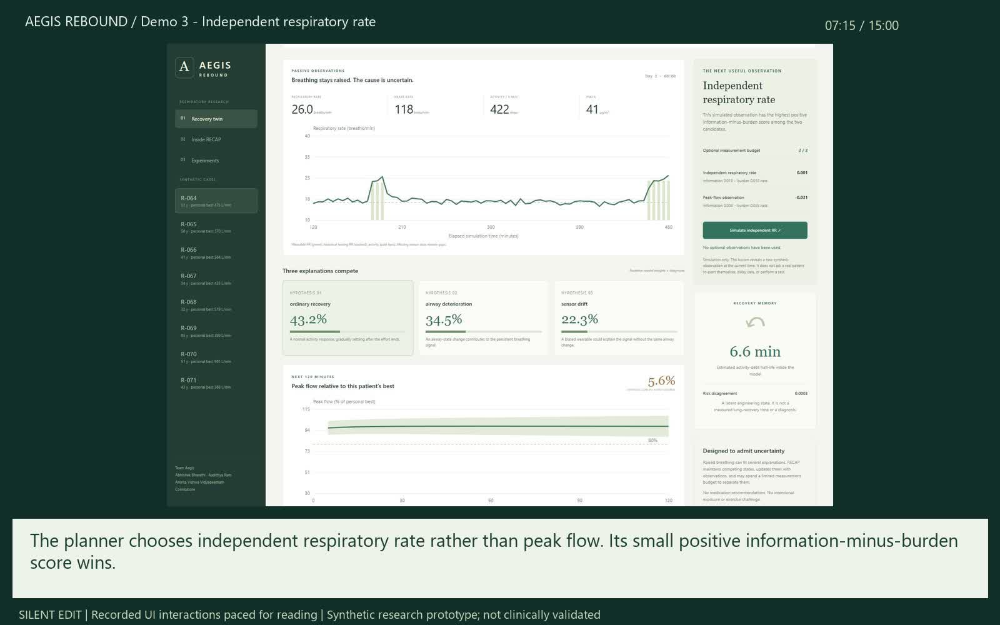

# Aegis REBOUND

### A respiratory digital twin that chooses the next useful observation

**Digital Twin Challenge 2026 · Team Aegis**<br>
**Abhishek Bharathi · Aadithya Ram**<br>
**Amrita Vishwa Vidyapeetham, Coimbatore** · Independent student team; no incubator affiliation

[Watch the 20:30 project walkthrough](submission/Aegis_REBOUND_Demo.mp4) · [Silent product demo — 15:00](submission/Aegis_REBOUND_15min_Overview.mp4) · [Presentation](submission/Project_Presentation.pdf) · [Architecture](submission/Architecture.pdf) · [Technical report](submission/Technical_Report.pdf)



## Problem and healthcare use case

After everyday activity, breathing can remain elevated for different reasons: ordinary recovery, an airway-state change, or wearable sensor drift. A single risk score gives a clinician little help distinguishing those explanations or deciding which observation would clarify them.

**REBOUND maintains competing virtual-patient states, forecasts peak-flow trajectories, and selects an additional simulated observation only when its expected information justifies its burden.** It combines personal historical EHR information with a changing wearable/context stream in a focused adult-asthma proof of concept.

The forecast target is **three consecutive five-minute peak-flow values below 80% of personal best within the next 120 minutes**. This synthetic low-PEF endpoint includes ongoing low states; it is not a clinically adjudicated asthma attack. All records are generated by the included simulator, as permitted by the challenge sandbox.

## Review the prototype

1. **Watch:** the [20:30 walkthrough](submission/Aegis_REBOUND_Demo.mp4) covers the problem, algorithm, interface, experiments and outcomes. It contains disclosed computer narration and presentation/application captures. The [silent 15:00 edition](submission/Aegis_REBOUND_15min_Overview.mp4) adds seven captioned product-demo chapters; it is a supplementary shorter version.
2. **Run:** launch the dashboard using the instructions below. Inspect competing hypotheses, play the timeline, assimilate a simulated observation, and compare the resulting state.
3. **Inspect:** read the [algorithm](docs/ALGORITHM.md), [results and comparisons](docs/RESULTS.md), [model/data card](docs/MODEL_DATA_CARD.md), and [related work](docs/PRIOR_ART.md). Equations, artifacts and tests are included.

Videos are hosted directly in this public repository. If GitHub does not play a video inline, use **View raw** or **Download raw file** on its file page.

## Run locally

Python 3.11+ and NumPy are required. No GPU, API key, model service or external account is needed. After dependencies are installed, the application runs offline.

**Windows:** double-click [`START_WINDOWS.bat`](START_WINDOWS.bat). It creates a virtual environment, installs NumPy if needed, and opens the dashboard at `http://127.0.0.1:8766`.

```bash
python -m venv .venv
# Windows: .venv\Scripts\activate
# macOS/Linux: source .venv/bin/activate
python -m pip install -r requirements.txt
python app.py
```

Use `python app.py --port 8767` to choose another port. Stop the local development server with Ctrl+C. See [the quick demo guide](START_HERE.md) for a step-by-step evaluation route.

## RECAP: the implemented algorithm

**Recovery-conditioned Ensemble with Cost-Aware Probing** combines:

- **Personal conditioning:** historical resting HR/RR, personal-best peak flow and history-based priors initialize the observation models and hypothesis bank.
- **Competing dynamic states:** three explanations × three recovery settings form nine Kalman filters tracking an airway proxy, trend, activity debt and sensor bias.
- **Sequential evidence:** causal observations update states and model weights through time; the forecast is a mixture over the competing components.
- **Budgeted active sensing:** Gaussian quadrature approximates information gain for peak flow or independent respiratory rate, subtracts assumed burden, and compares against waiting.
- **An observable feedback loop:** a selected synthetic measurement changes the state and hypothesis weights. Two optional probes per day and a two-hour cooldown bound the interaction.
- **Missing-data abstention:** insufficient fresh observations suppress hypothesis ranking and event probability until data quality recovers.

The contribution is this executable recovery-aware hypothesis-bank and observation-selection workflow. It builds on established state estimation, model averaging and active-sensing methods; [related work](docs/PRIOR_ART.md) identifies those foundations. The planner approximates information gain by updating hypothetical model weights while holding component risk indices fixed.

## Evaluation and outcomes

A patient-disjoint synthetic experiment uses **48 training, 16 calibration and 24 held-out test patients**, with 904 eligible test forecast windows. The dashboard reads the included [canonical experiment JSON](artifacts/metrics.json); [raw test predictions](artifacts/test_predictions.csv) are available for inspection.

- Passive RECAP achieved **AUROC 0.9433**, **Brier 0.06432**, and **84.23% sensitivity** at a 0.5 threshold in this experiment.
- Adaptive sensing used **38 optional observations versus 48** for fixed scheduling: **20.8% fewer**, with Brier **0.05933 versus 0.06218**. Both policies had the same maximum two additional observations per patient.
- The adaptive-minus-fixed patient-mean Brier difference was **−0.002823**, with paired patient-bootstrap 95% interval **[−0.005359, −0.000164]**.
- Removing personal EHR baselines reduced AUROC to **0.8007**. A shifted synthetic cohort achieved AUROC **0.9059**.

The evaluation includes all baseline comparisons: a simpler wearable/context classifier had a better Brier score than passive RECAP, and recovery diversity did not improve event classification in this run. REBOUND's demonstrated distinction is its inspectable evolving state and bounded observation-selection workflow. Full interpretation and study boundaries are in [RESULTS.md](docs/RESULTS.md).

Reproduce the benchmark and run the tests:

```bash
python -m rebound.benchmark
python -m unittest discover -s tests -v
```

## Technical stack and repository guide

Python and NumPy implement the simulator, filters, calibration and benchmark. A standard-library HTTP server serves a responsive HTML/CSS/JavaScript clinician workspace with local SVG plots. Forecasting runs through explicit numerical models.

- `rebound/` — synthetic population generator, RECAP and benchmark.
- `data/` and `artifacts/` — eight demo streams, calibration, measured results and raw predictions.
- `web/` and `app.py` — dashboard, replay, exports and local API.
- `tests/` — future-data isolation, inference boundaries, observation updates, budgets, missingness and API checks.
- `docs/` — equations, data/model specification, related work, results and design rationale.
- `submission/` — videos, architecture, presentation, technical report and editable demo assets.
- [Deliverables index](submission/DELIVERABLES.md) — challenge requirements mapped to reviewable files.

## Scope and license

This is a synthetic research prototype. Hypothesis weights are model explanations, not diagnoses; forecast bands are uncalibrated mixture moments. The data and measurements are invented, and performance has not been clinically validated. The interface provides no treatment or medication recommendations. Independent longitudinal data and clinical evaluation are required to establish patient benefit.

Original source, synthetic data and project diagrams are released under the [MIT License](LICENSE). [MANIFEST.sha256](MANIFEST.sha256) provides release-file checksums.
